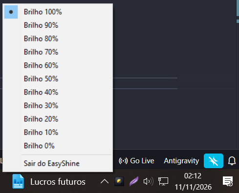

<p align="center">
  
</p>

<h1 align="center">EasyShine</h1>

<p align="center">
  O <b>EasyShine</b> é um aplicativo leve e simples para Windows que permite ajustar o brilho da sua tela diretamente pelo ícone ao lado do relógio.
</p>

<p align="center">
  Ideal para escurecer o monitor à noite, economizar a visão e trabalhar de forma mais confortável em ambientes escuros.
</p>

---

## 🆗 Visualização

<p align="center">
  
</p>

Visualização do aplicativo em funcionamento.

---

## 🧾 Recursos

* 🌄 **Fácil de usar:** Altere o brilho de 0% a 100% com apenas dois cliques.
* 📄 **Suporte a múltiplos monitores:** Funciona em todas as telas conectadas ao computador.
* 🤫 **Silencioso:** Roda em segundo plano na barra de tarefas (ao lado do relógio) sem atrapalhar o seu uso.
* 🐰 **Compatível:** Feito para Windows 10 e Windows 11 (64 bits).

---

## 🛠 Como Baixar e Usar

1. Acesse a área de [**Releases**](../../releases) aqui no GitHub.
2. Baixe o arquivo **EasyShine.exe**.
3. Dê um duplo clique no arquivo para abrir o programa.
4. Procure pelo ícone do **EasyShine** na barra de tarefas (ao lado do relógio do Windows).
5. Clique com o **botão direito** no ícone e escolha o nível de brilho desejado.

> 💨 **Dica:** Para fechar o aplicativo completamente, basta clicar com o botão direito no ícone e selecionar **"Sair do EasyShine"**.

---

## ⚙ Como Executar o Código Fonte (Para Desenvolvedores)

Se você deseja rodar o projeto diretamente pelo Python:

### Pré-requisitos

* **Python 3.10+** (64 bits) instalado no Windows.

### Passos

1. Clone este repositório:

    ```console
   git clone https://github.com/seu-usuario/EasyShine.git
    ```
2. Entre na pasta do projeto:
    ```console
      cd EasyShine
    ```

3. Instale as dependências:
    ```console
      pip install -r requirements.txt
    ```

4. Execute o projeto:
    ```console
      python main.py
    ```

5. Como Compilar para Executável (.exe)
    ```console
      pyinstaller --clean --noconsole --onefile --icon=ico.ico --add-data "ico.ico;." main.py
    ```

O executável pronto estará disponível na pasta dist/.

### 📀 Licença

Este projeto está sob a licença MIT. Veja o arquivo LICENSE para mais detalhes.
